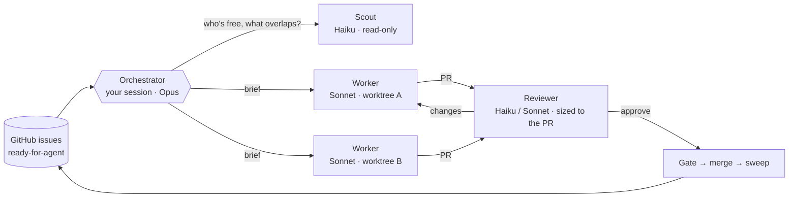

# orchestrate

**Turn a backlog of GitHub issues into reviewed, merged pull requests, several at a time, from one Claude Code session.**

[](https://github.com/shrujancheruku/claude-orchestrate/releases/latest)
[](https://code.claude.com/docs/en/plugins)
[](#development)
[](LICENSE)

You write the tickets. orchestrate runs the rest: it picks what to build next, gives each ticket to its own agent in its own git worktree, reviews every PR at a depth that fits it, and merges by your repo's rules. It stops for anything that's yours to decide.

```
/orchestrate:setup    # once per repo: scouts the codebase, asks you a few questions
/orchestrate:run      # works the backlog until nothing is left to take
/orchestrate:run --greedy --profile   # as many tickets at once as don't collide, with a cost and slot profile
```

---

## Why

A coding agent can build one ticket well. Running five at once by hand is where it gets hard: two agents edit the same file, a PR goes stale behind main, a review costs more than the change it reviews, a usage limit kills everything halfway through, and your own session fills up with diffs and logs.

orchestrate is the coordination layer for that. Your session becomes a **project lead** that keeps decisions and drops the noise. Cheaper agents do the legwork, and the state lives in GitHub, not in the chat.

## How it works



| Role | Runs on | Does |
|---|---|---|
| **Orchestrator** | your session (e.g. Opus) | Orders the work, writes briefs, reads verdicts, merges, asks you at gates. Writes no feature code. |
| **Worker** | Sonnet (Haiku for small tickets) | Builds one ticket end to end in an isolated worktree and opens its PR. |
| **Reviewer** | Haiku for S, Sonnet for M and L | Reviews one PR against its ticket and your repo's rules, and posts the review on the PR. |
| **Scout** | Haiku | Finds facts: the takeable tickets, which files each will touch, CI and merge state. |

Each run is a **pass**: rebuild state from the tracker, review and merge finished PRs, fill free slots with new workers, report. Then the orchestrator goes quiet and wakes only when a worker finishes, a reviewer returns or CI settles.

## What you get

**Parallel without collisions.** Before a ticket starts, the scout predicts which files it will touch. Two tickets run side by side only when those predictions don't overlap. Files every PR edits (a changelog, a route index) get per-PR rules, and after each merge a sweep updates every other open PR that now conflicts, replaying their lines onto main.

**Reviews sized to the change.** A ten-line fix gets a Haiku checklist. A change to auth gets a high-effort Sonnet review with risk notes for humans. Before any reviewer starts, a script gate checks mergeability, the PR title and your repo's own checks, so the cheap failures never cost a review.

**The cheapest model that does the job well.** Searches and log reads stay in Haiku contexts. Review fixes go back to the worker that wrote the code, reusing its context. Briefs share a prompt-cache prefix. The slot count is your throttle, and every pass suggests whether to raise or lower it; `--greedy` sizes it for you from how many tickets can run at once.

**Guardrails.** A hook reads every shell command a plugin agent runs, with its own shell lexer, and refuses whatever that role must not do: scouts and reviewers can't write, workers can't merge or force-push. A command it can't parse is refused.

**It picks up where it stopped.** State lives in GitHub issues and PRs, so a pass is safe to repeat and safe to start in a fresh session. When a usage limit hits, dispatching stops, affected tickets show as paused, and the next pass after the reset continues each worker with its context.

**You decide what's yours.** Gates on tickets, labels or paths wait for your go-ahead. Anything destructive or outward-facing that the config doesn't authorise waits too. A ticket a worker can't finish goes back to the tracker as `ready-for-human` or `needs-info`, with the reason.

**Measurable.** `--profile` records each pass and writes a JSON profile plus an HTML viewer: cost per merged ticket by model and role, slot utilisation, review quality, context growth. A `compare` command judges a trial against a baseline.

```
Profile · session 346d1ea2 · 2026-11-03T16:01Z → 2026-11-03T16:22Z (21m) · 2 slots
proxy $ $3.09 per merged ticket (2 merged): opus $1.52 · sonnet $1.35 · haiku $0.22 · orchestrator $1.52
slots   occupied 59%  (building 37%, review/merge 22%)  idle: overlap 5m, empty 7m
```

## Quickstart

```sh
/plugin marketplace add shrujancheruku/claude-orchestrate
/plugin install orchestrate@claude-orchestrate
```

You need `git` 2.38+, `gh` (signed in) and `python3` 3.9+.

1. **Write tickets.** orchestrate works the GitHub issues labelled `ready-for-agent`. It pairs with [Matt Pocock's skills](https://github.com/mattpocock/skills): `to-spec` and `to-tickets` write the backlog, `triage` labels it, and `/setup-matt-pocock-skills` writes the tracker and domain docs orchestrate reads.
2. **`/orchestrate:setup`** scouts the repo (tracker, commands, layout, conventions, files that would collide across worktrees) and asks you in one round: slots, gates, who merges, models, review tiers. It writes `.claude/orchestration.md`.
3. **`/orchestrate:run`** starts working. `/orchestrate:run status` reports without acting; `/orchestrate:run <issue>` narrows to one ticket or one parent's sub-issues. Add `--greedy` to run every ticket that doesn't collide with another (up to 5 at once) instead of the config's slot count, and `--profile` to save what the session cost and how busy its slots were ([guide](docs/guide.md#choosing-a-slot-count)).

## Documentation

- **[The full guide](docs/guide.md):** concepts, cost, slot counts, the guard hook, the merge sweep, sandboxed pushes, usage limits, profiling and development.
- **[Glossary](GLOSSARY.md):** the shared vocabulary of the prompts, scripts and docs.
- **[Architecture decisions](docs/adr/):** why slots default to 2 and when `--greedy` sizes them, why the guard fails closed, who owns the merge sweep, and more.

## Development

Plain Python 3.9+, standard library only, no build step.

```sh
python3 -m unittest discover tests                              # unit and integration tests
ORCH_BEHAVIOUR=1 python3 -m unittest discover tests/behaviour   # real headless agents, opt-in, capped at $1 a run
```

A regression corpus of every distinct shell command the plugin's agents have run in real sessions pins the guard's decisions. See [Development](docs/guide.md#development) in the guide.

## Limits

- Workers branch from the default branch, so a ticket starts only after its dependencies have merged.
- Plugin agents ignore `permissionMode`, so workers follow your session's permission mode.
- The guard is a guardrail against mistakes, not a sandbox. Your permission mode and sandbox settings still apply on top.

## License

[MIT](LICENSE)
