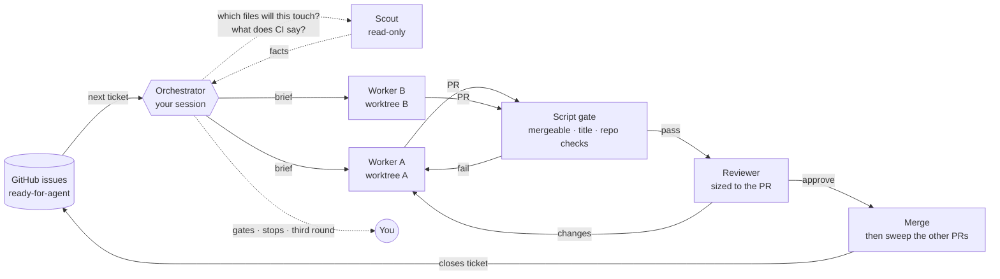
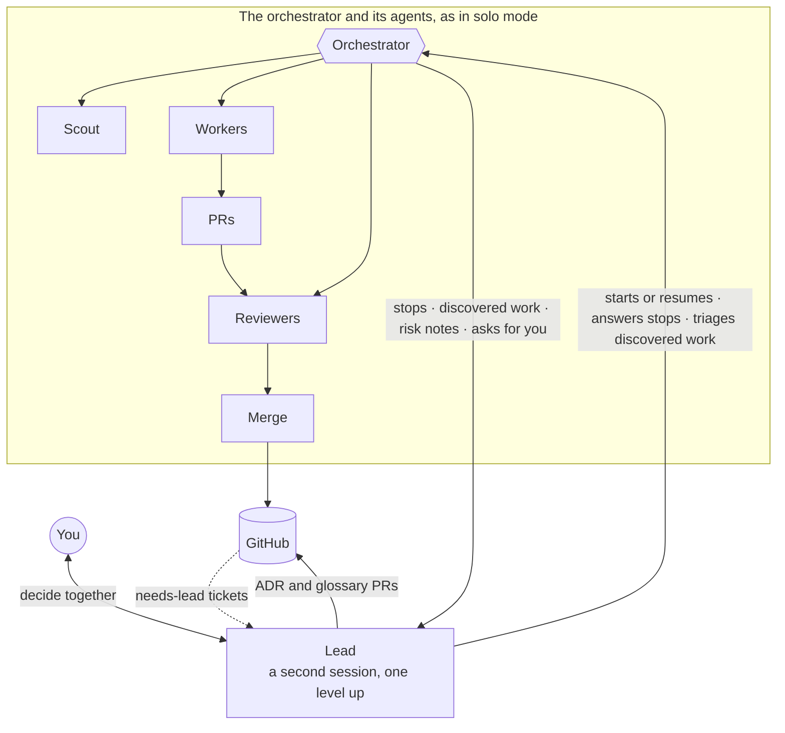
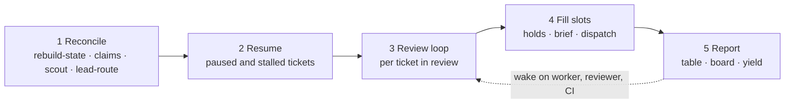
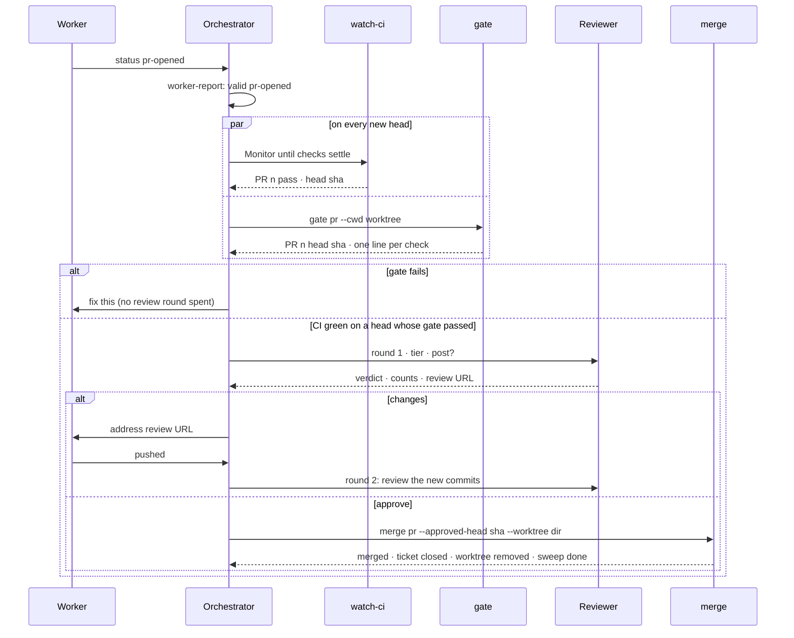

# orchestrate

**Turn a backlog of GitHub issues into reviewed, merged pull requests, several at a time, from one Claude Code session.**

[](https://github.com/shrujancheruku/claude-orchestrate/releases/latest)
[](https://code.claude.com/docs/en/plugins)
[](#development)
[](LICENSE)

A coding agent can build one ticket well. Hand it five and the problems start: two agents edit the same file, a PR goes stale behind main, a review costs more than the change it reviews, and a usage limit kills everything halfway through. orchestrate is the team around the agent. You write the tickets. It picks what to build next, gives each ticket to a worker in its own git worktree, reviews every PR at a depth that fits it, merges by your repo's rules and keeps the other branches current. Everything that is yours to decide waits for you; everything else just happens.

## Get started

```sh
/plugin marketplace add shrujancheruku/claude-orchestrate
/plugin install orchestrate@claude-orchestrate
```

You need `git` 2.38+, `gh` (signed in) and `python3` 3.9+.

```
/orchestrate:setup                     # once per repo: scouts the codebase, asks you a few questions
/orchestrate:run                       # works the backlog until nothing is left to take
/orchestrate:run --greedy --profile    # as many tickets at once as don't collide, with a cost profile
claude --name lead "/orchestrate:lead" # optional: a lead session that starts and supervises the orchestrator
```

1. **Write tickets.** orchestrate works the GitHub issues labelled `ready-for-agent`. It pairs with [Matt Pocock's skills](https://github.com/mattpocock/skills): `to-spec` and `to-tickets` write the backlog, `triage` labels it, and `/setup-matt-pocock-skills` writes the tracker and domain docs orchestrate reads.
2. **Run `/orchestrate:setup`.** It scouts the repo and asks you, in one round, about slots, gates, who merges, models and review tiers. It writes `.claude/orchestration.md`, the config every agent reads.
3. **Run `/orchestrate:run`.** It works until the backlog is empty or everything left needs you. `status` reports without acting, `<issue>` narrows to one ticket or one parent's sub-issues, `--greedy` runs every ticket that doesn't collide with another, and `--profile` records what the session cost.
4. **Add a lead (optional).** `claude --name lead "/orchestrate:lead"` starts the whole system in one command and puts a planner above the orchestrator to answer its questions, triage what it discovers and write decisions down ([lead mode](docs/guide.md#lead-mode) in the guide covers the two-terminal start and each fallback).

## How it works

Your session becomes the **orchestrator**. It never writes feature code. It decides the order of work, hands each ticket to a **worker** in its own worktree, sends each finished PR to a **reviewer**, and asks a **scout** whenever it needs a fact. Everything the agents produce lands in GitHub: branches, PRs, reviews, labels and comments. The orchestrator holds only decisions, so it can be interrupted, resumed or restarted in a fresh session and pick up exactly where it was.

### Solo mode



Each run is a **pass** with five steps: rebuild state from the tracker, resume anything paused, finish work in review, fill free slots with new workers, report. Then the orchestrator goes quiet and wakes only when a worker finishes, a reviewer returns or CI settles. Two tickets run side by side only when the files they are predicted to touch don't overlap. A worker that hits a question it cannot answer from the ticket, the config or the code stops and asks. In solo mode that question comes to you: the ticket is labelled `needs-info` or `ready-for-human` and handed back to the tracker with the reason.

### Lead mode



A **lead** is an optional second session that sits above the orchestrator. It is detected, not configured: a live session named `lead` turns lead mode on. With a lead, a worker's stop becomes a `needs-lead` ticket that the lead answers on the tracker, and the worker resumes with its context intact. The lead triages the work workers and reviewers discover outside their tickets, weighs the risk notes of large PRs, and records each settled decision as an architecture decision record through a PR of its own, which the orchestrator reviews and merges like any other. It never builds, reviews, merges or dispatches workers, so the orchestrator keeps doing all of that. If the lead goes away, every stop falls back to you.

Both modes are the same pipeline. The lead changes where questions go, not how work gets built.

### What you get

- **Parallel without collisions.** The scout predicts the files each ticket will touch. A ticket runs only when its prediction overlaps no open PR, no building ticket and no exclusive hold. After every merge a sweep updates the open PRs that now conflict, replaying each PR's lines in the files everyone edits, such as a changelog.
- **Reviews sized to the change.** A small fix gets a Haiku checklist. A medium change gets a Sonnet correctness review. A change to auth or a migration gets a high-effort Sonnet review with risk notes for humans. A script gate runs before any reviewer, so a bad title or a conflict never costs a review.
- **The cheapest model that does the job.** Searches and log reads stay in Haiku contexts. Review fixes go back to the worker that wrote the code, so its context is reused. A small ticket starts on Haiku and escalates to Sonnet once if it struggles. The slot count is your throttle, and `--greedy` sizes it from how many tickets can run at once ([choosing a slot count](docs/guide.md#choosing-a-slot-count)).
- **Guardrails.** A hook reads every shell command a plugin agent runs and refuses what that role must not do. Scouts and reviewers cannot write, workers cannot merge or force-push, and a command the hook cannot parse is refused ([the guard hook](docs/guide.md#the-guard-hook)).
- **It picks up where it stopped.** State lives in GitHub and a rebuilt cache, never in the chat. A usage limit pauses workers; the next pass resumes each one with its context. A session that died leaves nothing behind that the next pass cannot find ([running out of usage](docs/guide.md#running-out-of-usage)).
- **You decide what's yours.** Gates on tickets, labels or paths wait for your go-ahead. Anything destructive or outward-facing the config doesn't authorise waits too.
- **Measurable.** `--profile` writes a JSON profile and an HTML viewer: cost per merged ticket by model and role, slot utilisation, review quality and context growth ([profiling](docs/guide.md#profiling)).

## Meet the team

Five roles. Each has its own agent definition, model and guard rules, and a temperament to match.

### The orchestrator

*The calm coordinator. Holds the order of work and every judgement call.*

Defined by `skills/run/SKILL.md`. It runs in your session on the model you pick (Opus fits well; a lead launches it on the config's model). It reads the config and the tracker docs once, then works from a rebuilt picture of the tracker each pass. It writes each worker's brief as pointers, never copies: the ticket URL, the touch map, the held paths, the branch, the verify command. It reads verdicts, not findings; a posted review returns to it as a verdict, counts and a URL. Every shell command it runs has bounded output, so its context holds decisions rather than diffs and logs. Between events it ends its turn, and wakes on worker and reviewer completions and on a `watch-ci` line that says a PR's checks have settled.

What it decides: which ticket is next, which model builds it, whether an overlap holds it, what to do with each worker report, which tier reviews a PR, when to merge, when to escalate a Haiku worker to Sonnet, and what reaches you. What it never does: write feature code, read a diff, merge by hand, or answer a question the config, ticket and code cannot settle.

### The worker

*Heads-down and thorough. Builds one ticket end to end and opens its PR.*

Defined by `agents/worker.md`. Each worker gets one ticket and its own git worktree, created by the harness. It runs on Sonnet, or Haiku for small tickets. It has no `Agent` tool, so it cannot spawn helpers, and its guard rules refuse `gh pr merge`, force-pushes and pushes to `main`.

It reads the ticket with every comment as the spec, then the glossary and the ADRs that touch its area. Before it branches, it checks whether the default branch already meets every acceptance criterion and stops if so. It builds test-first, fetches every external fact from a primary source and keeps the URL for the PR's evidence, commits as it goes and pushes after every green commit, so a usage limit loses almost nothing. It runs the config's verify commands through one script, once, in the foreground. Right after it orients it opens a **draft PR** (an empty `chore: start #<n>` commit, then `gh pr create --draft`) so you can follow the work; a draft counts as building, and the worker marks it ready when it ships. It opens the PR with the repo's title convention and closing reference, records any **discovered work** in the PR body, and reports in about ten lines: `status`, PR, branch, verify result, and on a stop, why.

It stops for a held path it must change, a ticket with no acceptance criteria, an ambiguity that changes the design, an ADR it would have to contradict, a human-only step, a verify failure outside its ticket, or an external fact it could only state from memory. It never stops for an unfinished commit, push or PR: those are the steps still ahead of it.

### The reviewer

*Sharp-eyed and fair. Reviews to the size of the PR, no more and no less.*

Defined by `agents/reviewer.md`. It reads one PR against its ticket and the repo's rules, and returns a verdict. It is read-only: the guard refuses every git and `gh` write except posting one comment review on the PR, and only when the config allows posting. It may check the PR head out into a scratch worktree and run one narrow test when reading cannot settle a finding.

It judges on two axes, **spec** (does the PR do what the ticket asks, no more and no less?) and **standards** (does it follow the repo's rules, glossary and ADRs?). Its depth comes from the PR's **tier**:

| Tier | Model | What it checks |
|---|---|---|
| S | Haiku | Every acceptance criterion addressed, behaviour changes tested, nothing outside the ticket, conventions held, external facts sourced |
| M | Sonnet | S, plus each change read in context with its callers, edge cases handled, tests that would fail without the change, no silent ADR contradiction |
| L | Sonnet, high effort | M, plus **risk notes**: where a wrong change is costly (migrations, auth, public API, data deletion, concurrency) and exactly what a human should look at there |

Each finding names a `path:line` and either a concrete failure or the rule it breaks, and is marked `[blocking]` or `[minor]`. `approve` means no blocking findings; minors ride along for the worker to take or leave. Work outside the ticket's scope is never a finding but **discovered work**, listed for the lead or for you. When posting is on, the findings go on the PR as inline comments and the reviewer returns about 150 tokens; the worker reads the findings from the PR itself. Later rounds continue the same reviewer, so it checks its own earlier findings against the new commits.

### The scout

*Curious and quick. Finds facts and never touches anything.*

Defined by `agents/scout.md`. It runs on Haiku at low effort with a turn cap, is read-only by the guard, and does not load the repo's `CLAUDE.md`. It answers the questions the orchestrator would otherwise dig for itself, each in a fixed shape so the orchestrator reads conclusions rather than evidence:

- **Reconcile:** the check states of the in-review tickets. The takeable tickets, the `ready-for-human` ones and the parents whose sub-issues have all closed come from `scripts/frontier`. Each claimed ticket's state, worktree and unpushed work come from `scripts/claims`, not the scout.
- **Touch map:** the files a ticket will most likely change, each as `path:line` of its entry point. A prediction, not a fence.
- **CI and PRs:** each check's state by name, the failing step of a failed run, how far a branch is behind its base, and unresolved review comments.
- **Environment:** build and test commands, tool versions, anything that would collide across parallel worktrees.

It reports what is true, with the command or `path:line` that shows it, and leaves recommendations out.

### The lead

*The thoughtful planner, one level above. Answers the orchestrator's stops and keeps the record.*

Defined by `skills/lead/SKILL.md`. Fable is recommended for it. Started with `claude --name lead "/orchestrate:lead"`, it checks its own name, reads the config and tracker docs, runs `scripts/lead-brief` for its index (glossary, ADR list, open `needs-lead` and `lead` tickets, the roadmap, and the PRs merged since its watermark with each large merge's risk notes), then finds the orchestrator. A live `orchestrator` session is reached by message. A stopped one is resumed. None is launched, in the background, on the config's model.

Its moves are the part you talk to. **Settling a stop:** answer on the ticket, edit the spec if the answer changes it, remove `needs-lead`, nudge the orchestrator; or split the ticket, or close it `wontfix`. **Settling an ADR conflict:** decide, then release the held PR or file a follow-up. **Discovered work:** dedupe against the backlog and turn what is real into tickets, as `needs-triage` drafts when you are away and as `ready-for-agent` only after triage with you. **Risk notes:** each gets one outcome, taken in, sent to a scout to check, or filed as a ticket. **Decision PRs:** each settled decision lands as one PR with the ADR and its glossary terms, behind a ticket the lead filed and claimed with the `lead` label; the orchestrator runs it through the same gate, review and merge as any other PR. It also measures CI wait every ten merges and drafts a CI-speed ticket when the p90 is over the limit.

It never builds, reads diffs, reviews, merges or dispatches. Your questions from the orchestrator pass through it to you without being decided.

## The full technical rundown

What happens to one ticket, from the moment it is takeable to the moment its PR is merged. File paths point at the plugin's sources.

### Before the first pass

`/orchestrate:run` reads `.claude/orchestration.md` in full. The config is the single source for the backlog, slots, verify commands, shared files, gates, merge rule, models and review tiers, and it wins over the skill text. Then it reads the tracker docs the config points to, normally `docs/agents/issue-tracker.md` and `docs/agents/triage-labels.md`, and uses that repo's label strings and commands for every tracker operation. It checks its own session name is `orchestrator` and refuses to run beside another live session with the same name. It reads all of this once per session and again after a compaction, never otherwise.

### State lives outside the session

A ticket is **takeable** when `scripts/frontier` lists it. Takeable tickets go in ascending issue number, because `to-tickets` publishes blockers first. A ticket is **claimed** when it is assigned to the user, and the config's **slot** count caps how many claimed tickets are open at once. Each claimed ticket is in one state: **building**, **stalled** (no ready PR and no live worker anywhere), **Elsewhere** (another live session's worker is on it), **in review**, **with the lead**, or **done**. The orchestrator layers three states of its own on top from what it saw this session: **paused** (its worker hit a usage limit), **waiting** (on you or the lead) and waiting on a lead that could not be reached.

The one thing the tracker cannot hold is which agent built what. `scripts/rebuild-state` rebuilds `.claude/orchestrate-state.json` at the start of every pass from the session's own transcripts, joining each worker to its ticket by the `#<n>` in its dispatch description, and recording its agent ID, worktree, model, last report and touch map. The orchestrator never writes this file, so it cannot drift from what ran, and the tracker overrules it whenever they disagree.

`scripts/claims` is the one place that decides a claimed ticket's state. With one tracker read it prints a line per claimed ticket: state, branch, PR, the worker and model the state file records, the worktree, its lock and whether it holds uncommitted or unpushed work. Liveness across sessions comes from that worktree lock, which the harness writes with the session's process ID. A live process means the ticket is Elsewhere and this session leaves it alone. A dead one means the ticket is stalled and can be rescued. The orchestrator never reads the state file or compares locks by hand; it reads the claims line.

### A pass, step by step



1. **Reconcile.** Read the tracker once with `scripts/snapshot`, rebuild the state file, then read `scripts/claims` for the state of every claimed ticket. One scout call returns the check states of the in-review PRs; `scripts/frontier --all` lists the takeable tickets, the `ready-for-human` ones, parents with all sub-issues closed and any drift. Lead mode is detected from the live sessions. Then `scripts/lead-route` reads the tracker and the state file and prints one routing verdict per ticket that needs one: `RESUME` a worker whose stop was answered, `REDISPATCH` one that is gone, `FALLBACK` a `needs-lead` ticket to `needs-info` because the lead left, `UNCAP` one that has waited over thirty minutes so it stops holding a slot, `HANDBACK` one the lead split so it now has an open blocker, `ABANDON` one closed `wontfix`, `HOLD-PR` one whose ADR conflict is unsettled, `LEAD-PR` the lead's own PR, and a final `counted: k of cap`. The orchestrator applies each line word for word.
2. **Resume.** A paused worker is continued with a message once the limit has lifted. A stalled ticket's old worktree is rescued first, by `scripts/rescue`: anything uncommitted is committed as `chore(wip): …`, pushed, and the worktree removed (it refuses a live lock from another session); if that work touches a path another ticket holds, the redispatch is held and the paths go to you. Then a fresh worker continues the branch.
3. **The review loop**, for each ticket with a ready (non-draft) PR. Described below.
4. **Fill free slots.** For each free slot, take the next `frontier` line that no start gate holds. Assign it to the user first, so another session skips it. Then run `scripts/holds --touch-map <files> --ticket <n>`. It is the one place the overlap rule lives: a path is held by an open PR's diff, a building ticket's touch map, the changed files of an Elsewhere ticket's live worktree, or an exclusive hold in the config. Exit 1 is an overlap outside the config's shared files and the ticket waits; the next ticket is tried instead. Otherwise the orchestrator writes the brief from `skills/run/brief.md`, pointers only with a fixed preamble so workers share a prompt-cache prefix, picks the model, and dispatches `orchestrate:worker` in the background with the description `Build #<n>`.
5. **Report and yield.** A table of tickets, states, next steps and who each waits on, headed `Lead: live` or `Lead: none`. Below it, a slot suggestion, the PRs carrying discovered work, the `ready-for-human` tickets and the parents ready to close. With a `Board:` line in the config, `scripts/board` syncs a GitHub Projects board. Then the orchestrator ends its turn.

### Choosing the worker model

One size scale sets both the worker model and the review tier. A ticket whose title or body says "investigate" or "design" goes to Sonnet whatever its size. A `size:S` label routes to Haiku; `size:M` and `size:L` to Sonnet. An unlabelled ticket goes to Haiku when its touch map names at most the config's S file limit (3 by default) and touches no risk path.

A Haiku worker escalates once, to a fresh Sonnet worker on the same branch and PR, on any of: a stop that is not your decision and cannot be answered in one message, a second CI failure, or "changes" again in review round 2. The orchestrator reads the recorded model from the ticket's claims line, never from memory, so this survives a compaction. Before the hand-over it checks that line for a live lock, makes sure the old worker's work is pushed, and only then dispatches the new one. A Sonnet worker is never escalated again.

### Inside the worker

The worker's steps are **orient, build, verify, ship, report**. It reads the ticket with every comment, where an `## Agent Brief` comment overrides the body. It reads the glossary and the ADRs for its area the way `docs/agents/domain.md` says. It fetches the remote and compares each acceptance criterion with the default branch using bounded commands; if every criterion is already met, it stops and says which commit shows it. If the brief's branch exists on the remote, it continues from it; otherwise it creates `<number>-<slug>` from the default branch.

It builds test-first, with the `tdd` skill when one is listed. Every external fact is fetched from a primary source and its URL kept for the PR's evidence. It commits as it goes with no attribution lines or trailers, and pushes after each commit whose verify passes. Under the sandbox it pushes with plain `git push`; if SSH is refused, it falls back once to HTTPS through `gh`'s credential helper, inline, and never turns the sandbox off.

Verify is `scripts/verify --config`, run once, in the foreground. The script reads the commands from the config's **Verify** section, runs each exactly as written, independently so every failure shows in one run, with a `--then` group skipped when something above it fails. It prints one pass, fail or skip line per command and the last forty lines of a failure. The guard refuses any backgrounded command from a worker, because a worker that backgrounds verify would hand back before it finished.

With a draft open, shipping is `gh pr edit --body-file` then `gh pr ready`; if the draft could not be opened, the PR is created at ship as before. GitHub Actions' `pull_request` trigger runs CI on every push to a draft; a repo that wants to skip that can add `if: ${{ !github.event.pull_request.draft }}` to its workflow, and must then also list `types: [opened, synchronize, reopened, ready_for_review]` under `pull_request`: `ready_for_review` is not a default type, so without it marking a PR ready runs no CI, the skipped jobs read as a pass, and the PR could merge untested (the plugin doesn't edit workflows). To ship, it stages files by explicit path, commits with the repo's convention, pushes, and opens the PR with the `:pr` skill when one is listed. The body carries the closing reference, an evidence list for each external fact and a `## Discovered work` section for anything the backlog is missing. It never merges or rebases the default branch into its branch on its own. Then it reports with a `status:` line and, on a stop, a `stop-reason:` from a fixed list: `held-path`, `no-spec`, `ambiguous`, `adr-conflict`, `human-only`, `verify-outside-ticket`, `already-done` or `no-primary-source`.

The orchestrator never reads that report by eye. It pipes the whole completion to `scripts/worker-report <ticket> --branch <branch>`, which prints one verdict and logs it: `valid pr-opened` with the PR and head taken from the host, `valid stopped` with its reason, `interim` for a progress note with no status, `duplicate` for a repeat of the last verdict, `not-a-stop` for a stop with no listed reason (the worker is told once to finish and report), `not-a-pr-opened` for a claimed PR that does not exist, `missing-report` for a bare completion notice, and `limit` or `error` for a worker that ended on a usage limit or API error.

### The review loop



1. **Gate and CI, in parallel, on every new head.** `scripts/gate <pr> --cwd <worktree>` is the one mechanical check before any reviewer. It prints the PR's head commit first, then one line per check: the title against Conventional Commits, mergeability with the base (a conflict fails; a branch that is merely behind passes and is updated at merge time), no overlap with held paths (it runs `scripts/holds --pr` itself), dependencies merged, no secrets added to the diff, a changed lockfile with its changed manifest, and each command the config's **Repo-specific checks** mark with `run:`. It appends a `gate` event to the run log. Exit 1 goes straight to the worker without waiting for CI and costs no review round. Exit 3 means GitHub still reports mergeability as unknown, so the gate is run again once CI settles. Meanwhile, for every PR whose checks are pending, one Monitor runs `scripts/watch-ci <pr>…` (one request per tick for all of them; a newly pending PR restarts it with the full list), which prints one line per PR as its checks settle, with the head commit, and wakes the orchestrator. The orchestrator never sleeps or polls.
2. **CI failed.** The failing step goes to the worker by message. A second CI failure on a Haiku worker's PR escalates instead.
3. **Ready for review** when CI is green on a head whose gate passed: the `watch-ci` line and the `gate` line carry the same head. A new head means both run again. After a compaction, the run log's last `gate` event for the PR says whether its head passed.
4. **Review.** The tier comes from the PR's diff and the config's thresholds, or a `size:` label on the ticket. Round 1 is dispatched with a pointer brief only: ticket, PR, round, tier, whether to post. Round 2 onwards continues the same reviewer by message. A posted review comes back as verdict, counts and URL; the findings never pass through the orchestrator's context.
5. **Changes requested.** The worker is told "address review `<url>`" and reads the findings from the PR itself. After three rounds the ticket waits for you. An approve with minors tells the worker to take or leave them, with CI alone gating the merge and no re-review. A push after approval needs no decision from the orchestrator: the merge script decides.
6. **Merge.** If a merge gate applies or the config says the orchestrator doesn't merge, the ticket waits for you. Otherwise, for a large PR whose review wasn't posted, the risk notes go on the PR as one comment first. Then `scripts/merge <pr> --method <squash|merge|rebase> --approved-head <sha> --worktree <dir>`:
   - It decides readiness first. A PR behind the default branch is updated with `gh pr update-branch` and the script exits 5; the loop goes back to step 1 for CI on the new head, with no re-review for a main-only update. A worker change since the approved head that touches a risk path or exceeds the S thresholds exits 6 and goes back to the same reviewer as the next round. After a merge lands, the script also updates every other approved PR that is behind (the orchestrator passes `--also-approved <pr>=<sha>` for each), so their CI runs together and one Monitor watches them all.
   - It merges with `--match-head-commit`, so a push after the review is a refusal rather than merged unreviewed code. It treats `gh pr merge`'s exit as unreliable and re-checks the PR until GitHub reports it MERGED.
   - Only then it deletes the remote branch (never the default branch or a fork's), closes the ticket if the host didn't, unlocks and removes the worker's worktree with a plain `git worktree remove` (never forced), and appends a `merge` event.
   - Then it **sweeps**: every other open PR whose branch now conflicts with the default branch is updated by the script itself. Under squash or merge it merges main into the branch and pushes plainly; under rebase it rebases and pushes with `--force-with-lease`. A conflict in a config **shared file** is resolved by replaying the PR's lines onto main, with a word-level three-way merge for a line both sides changed. A conflict in a **generated** file takes main's side and reruns the generate command against the PR's sources. Anything else is handed back: the branch is left untouched and the script prints `HANDBACK PR #n <branch>: <path> (<why>)` and exits 4. The orchestrator resumes that PR's worker with those lines as its conflict list, the one case in which a worker merges the default branch, always by merge and never by force.
7. **After the merge.** The slot is free. Any edits the config says only the orchestrator makes are batched into one `chore:` PR at the end of a pass with nothing in flight, and that PR runs the same gate, review and merge.

### Stops, hand-backs and the lead

A worker's `stopped` report is how the orchestrator decides, so it is never worked around. When the config, the ticket or the code settles the question, the orchestrator answers it and continues the same worker. When it is a human's decision, the ticket goes back to the tracker: `ready-for-human` for a human-only step, `needs-info` for an ambiguity the author must settle. The `ready-for-agent` label is removed so the ticket holds exactly one state role, the ticket is unassigned so the frontier stays truthful, and a comment starting `> *This was generated by AI during triage.*` says what is needed and which branch holds the work.

In lead mode, an ambiguity goes to the lead instead. The ticket gets `needs-lead`, keeps its claim, its slot and its touch map, and a stop comment starting `> *Stopped for the lead.*` carries the question. The orchestrator messages the lead with the comment's URL; a message the harness holds counts as not delivered, and the tracker remains the record the next pass re-routes from. The lead answers on the ticket and removes the label; the next pass's `lead-route` prints `RESUME` and the worker continues with its context. An ADR conflict in a worker's report follows the same path and holds the PR before merge while CI, gate and review still run. Discovered work is forwarded to the lead with the PR URL and the gists, and the orchestrator creates, labels and dedupes nothing itself.

The lead's own PRs, those closing a `lead` ticket, run the same loop with no worker: failures go to the lead by message, with a `> *Waiting on lead (not delivered).*` comment and a `RESEND` on the next pass when the message did not arrive. The lead never merges; the orchestrator does.

### The guard

`hooks/guard.py` runs as a `PreToolUse` hook on every Bash call and acts only on this plugin's agents, by their `orchestrate:<role>` agent type. It splits the command into shell words with its own lexer, following quotes, escapes, `$(...)`, heredocs and `sh -c`, decides on those words, and refuses a command it cannot parse. Scouts and reviewers are refused git writes, `gh` writes, file writes, redirects, builds and installs; a GraphQL query is allowed and a mutation refused; the reviewer alone may post one comment review in the shapes its definition shows, and only when the config says `Post reviews: yes`. Workers are refused `gh pr merge`, `scripts/merge`, force-pushes, pushes to `main` or `master`, any command run in the background, and a verify call without a Bash `timeout` of 600000 ms or more. A role the guard does not know is treated as read-only. It is a guardrail against mistakes, not a sandbox: your permission mode and sandbox settings still apply on top. Every distinct command the agents ran in real sessions lives in `tests/fixtures/guard-corpus.jsonl`, so a guard change that flips a decision shows up in a PR diff.

### Usage limits

Every agent draws on your plan, so a limit usually reaches several workers at once. The first usage-limit error in a pass stops all new dispatches and marks the affected tickets paused, with the reset time if the error gave one. Workers push after every green commit, so little is lost. While the limit holds and the orchestrator can still run, it schedules one-shot `status` passes in hops of at most an hour until the reset. When the limit lifts, each paused worker is continued with its context; one that cannot be reached is replaced on the same branch after its worktree is rescued. The orchestrator never switches an agent to another model to get around a limit. For unattended runs, turn on Claude Code's `autoContinueAtUsageLimit`.

### Scripts and the run log

Every mechanical rule the prompts once restated is a script under `scripts/`, found from the skill directory and run by path ([ADR-0003](docs/adr/0003-script-invocation.md), [ADR-0006](docs/adr/0006-mechanical-rules-become-scripts.md)). They share one exit-code convention so a broken environment never reads as a verdict: `0` ok, `1` a verdict (a check failed or an action was refused), `2` could not run (fix the environment and run it again), with codes above 2 for specific states each script documents.

| Script | Run by | What it does |
|---|---|---|
| `snapshot` | orchestrator, each pass | Reads the tracker once (issues, open and merged PRs) into `.claude/orchestrate-snapshot.json`; `claims`, `frontier`, `holds` and `lead-route` read it with `--snapshot` |
| `rebuild-state` | orchestrator, each pass | Rebuilds the state file from the session's transcripts |
| `claims` | orchestrator, each pass | The state of every claimed ticket: branch, PR, worker, worktree, lock and unpushed work |
| `lead-route` | orchestrator, each pass | Prints one routing verdict per ticket that needs one, from the tracker and the state file |
| `rescue` | orchestrator, for a stalled or stopped ticket | Commits, pushes and removes the ticket's worktree, then checks the saved paths for overlap |
| `holds` | orchestrator and `gate` | Decides what is held and whether a ticket or PR overlaps it |
| `worker-report` | orchestrator, on each worker completion | Classifies the completion text into one verdict and logs it |
| `threads` | worker, reviewer, orchestrator | Lists a PR's review threads, and resolves or reopens one with a reply (`fixed in <sha>`, `left: <why>`, `reopened: <why>`) |
| `verify` | worker | Runs the config's verify commands, one line per result |
| `watch-ci` | orchestrator, via a Monitor | Prints one line per PR as its checks settle, with the head commit; one `gh` request per tick for all PRs, every 30 s (60 s with three or more) |
| `gate` | orchestrator, before review | Title, mergeability, held paths, dependencies, secrets, lockfiles and the config's `run:` checks |
| `merge` | orchestrator, after approval | Readiness, merge, re-check, cleanup, then the sweep with shared-file replay |
| `board` | orchestrator, each pass | Syncs the optional GitHub Projects board |
| `lead-brief` | lead, at start-up | The lead's index, and the watermark it resumes from |
| `ci-times` | lead, every ten merges | Push-to-green median and p90, and whether CI is over the limit |
| `profile.py` | orchestrator with `--profile` | Records each pass and builds the JSON profile and HTML viewer |
| `sandbox-git` | setup, with your yes | Lets `git fetch`, `pull` and `push` run outside the sandbox over SSH |
| `guard-corpus` | you, in development | Adds real sessions' commands to the guard's regression corpus |

`gate`, `watch-ci`, `worker-report`, `threads`, `merge` and the sweep each append an event to `.claude/orchestrate-profiles/events.jsonl`, and `--profile` records each pass beside it. The profile reads both with the session's transcripts to report cost per merged ticket by model and role, slot utilisation and why idle slots were idle, review rounds and round-1 approval rate, workers by model and escalations, and the orchestrator's context size at each turn with its compactions.

## Documentation

- **[The full guide](docs/guide.md):** installing, configuring, slot counts, the guard, the sweep, lead mode, CI times, the Projects board, sandboxed pushes, usage limits, profiling and development.
- **[Glossary](GLOSSARY.md):** the shared vocabulary of the prompts, scripts and docs.
- **[Architecture decisions](docs/adr/):** why slots default to 2, why the guard fails closed, who owns the merge sweep, why workers have no `Agent` tool, why a lead sits above one orchestrator, and more.

## Development

Plain Python 3.9+, standard library only, no build step.

```sh
python3 tests/run_parallel.py   # one process per test module, in parallel
```

The opt-in behavioural tier, which runs real headless agents against a temp repo, the guard's regression corpus and the exit-code convention are in [Development](docs/guide.md#development) in the guide.

## License

[MIT](LICENSE)
