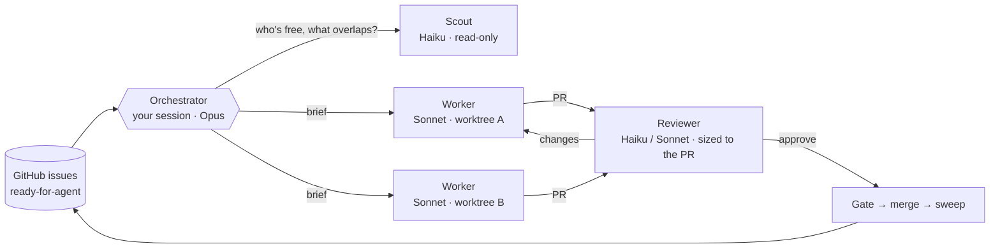

# orchestrate

**Turn your backlog of GitHub issues into reviewed, merged pull requests, several at a time, from one Claude Code session.**

[](https://github.com/shrujancheruku/claude-orchestrate/releases/latest)
[](https://code.claude.com/docs/en/plugins)
[](#development)
[](LICENSE)

A coding agent can build one ticket well. Five at once is where it falls apart: two agents edit the same file, a PR goes stale behind main, a review costs more than the change it reviews, and a usage limit kills everything halfway. orchestrate is the team that handles all of that. You write the tickets. It picks what to build next, gives each one to a worker in its own git worktree, reviews every PR at a depth that fits it, and merges by your repo's rules. It stops for anything that's yours to decide.

## Get started

```sh
/plugin marketplace add shrujancheruku/claude-orchestrate
/plugin install orchestrate@claude-orchestrate
```

You need `git` 2.38+, `gh` (signed in) and `python3` 3.9+.

```
/orchestrate:setup    # once per repo: scouts the codebase, asks you a few questions
/orchestrate:run      # works the backlog until nothing is left to take
/orchestrate:run --greedy --profile   # as many tickets at once as don't collide, with a cost and slot profile
```

1. **Write tickets.** orchestrate works the GitHub issues labelled `ready-for-agent`. It pairs with [Matt Pocock's skills](https://github.com/mattpocock/skills): `to-spec` and `to-tickets` write the backlog, `triage` labels it, and `/setup-matt-pocock-skills` writes the tracker and domain docs orchestrate reads.
2. **`/orchestrate:setup`** scouts the repo (tracker, commands, layout, conventions, files that would collide across worktrees) and asks you in one round: slots, gates, who merges, models, review tiers. It writes `.claude/orchestration.md`.
3. **`/orchestrate:run`** starts working. `/orchestrate:run status` reports without acting; `/orchestrate:run <issue>` narrows to one ticket or one parent's sub-issues. Add `--greedy` to run every ticket that doesn't collide with another (up to 5 at once) instead of the config's slot count, and `--profile` to save what the session cost and how busy its slots were ([guide](docs/guide.md#choosing-a-slot-count)).
4. **The lead (optional).** `claude --name lead "/orchestrate:lead"` starts the whole system in one command: it finds or launches the orchestrator, then answers its stops, triages discovered work and records decisions. It never builds, merges or dispatches workers. Without it, a stop becomes `needs-info` on the ticket, and ADR conflicts and discovered work come to you in the pass report. The [lead section](docs/guide.md#lead-mode) of the guide covers the two-terminal start and each fallback.

## Meet the team

Five roles, each with its own job and its own temperament. Each profile is what the agent's definition asks it to do.

### The orchestrator

*The calm coordinator. Keeps track of everything and makes the judgement calls.*

It runs in your session, on the model you pick (Opus is a good fit). It decides the order of work, writes each worker's brief, reads the verdicts, merges by your rules and asks you at the gates. It never writes feature code, and between events it goes quiet, waking only when a worker finishes, a reviewer returns or CI settles.

### The worker

*Hard-working and heads-down. Builds one ticket end to end and opens its PR.*

Each worker gets one ticket and its own git worktree. It reads the spec, builds it test-first, runs your verify commands and opens the PR. If it can't finish, it says why, and the ticket goes back to the tracker. It runs on Sonnet, or Haiku for small tickets, and it can't merge or force-push.

### The reviewer

*Sharp-eyed and fair. Reviews to the size of the PR, no more and no less.*

It checks one PR against its ticket and your repo's rules, at a depth set by the change. A small change gets a Haiku checklist. A medium one gets a Sonnet correctness review. A large change, or one that touches a risk path, gets a high-effort Sonnet review with risk notes for humans. It posts its review on the PR when your config allows, and it never edits the code.

### The scout

*Curious and quick. Finds facts and never touches anything.*

It answers the questions the orchestrator would otherwise dig for itself: which tickets are takeable, which files each one will touch, what CI and merge state look like, and what a PR still needs before it can merge. It runs on Haiku, is read-only, and reports what is true with its evidence, leaving the recommendations out.

### The lead

*The thoughtful planner, one level above. Answers the orchestrator's stops and keeps the record.*

The lead is an optional second session that sits above the orchestrator. It triages the work the orchestrator discovers, answers its stops and writes settled decisions down as ADRs and glossary terms, through its own PRs. It never builds, reviews, merges or dispatches workers, so the orchestrator keeps doing that.

## How it works



Each run is a **pass**: rebuild state from the tracker, review and merge finished PRs, fill free slots with new workers, report. The state lives in GitHub, not in the chat, so a pass is safe to repeat and safe to start in a fresh session. The [guide](docs/guide.md#use-it-in-a-repo) covers the details.

## What you get

**Parallel without collisions.** The scout predicts which files each ticket will touch, and two tickets run side by side only when those predictions don't overlap. Files that every PR edits get per-PR rules, and after each merge a sweep updates the open PRs that now conflict.

**Reviews sized to the change.** A small fix gets a Haiku checklist. A change to auth gets a high-effort Sonnet review with risk notes for humans. Before any reviewer starts, a script gate checks mergeability, the PR title and your repo's own checks, so the cheap failures never cost a review.

**The cheapest model that does the job.** Searches and log reads stay in Haiku contexts. Review fixes go back to the worker that wrote the code, so its context is reused. The slot count is your throttle, and `--greedy` sizes it from how many tickets can run at once ([guide](docs/guide.md#choosing-a-slot-count)).

**Guardrails.** A hook reads every shell command a plugin agent runs and refuses what that role must not do: scouts and reviewers can't write, workers can't merge or force-push, and a command it can't parse is refused. It's a guardrail against mistakes, not a sandbox ([guide](docs/guide.md#the-guard-hook)).

**It picks up where it stopped.** When a usage limit hits, dispatching stops and the affected tickets show as paused. The next pass after the reset continues each worker with its context ([guide](docs/guide.md#running-out-of-usage)).

**You decide what's yours.** Gates on tickets, labels or paths wait for your go-ahead, and anything destructive or outward-facing that the config doesn't authorise waits too. A ticket a worker can't finish goes back to the tracker as `ready-for-human` or `needs-info`, with the reason.

**Measurable.** `--profile` records each pass and writes a JSON profile plus an HTML viewer: cost per merged ticket by model and role, slot utilisation, review quality and context growth ([guide](docs/guide.md#profiling)).

## Documentation

- **[The full guide](docs/guide.md):** concepts, cost, slot counts, the guard hook, the merge sweep, the lead, CI times, the Projects board, sandboxed pushes, usage limits, profiling and development.
- **[Glossary](GLOSSARY.md):** the shared vocabulary of the prompts, scripts and docs.
- **[Architecture decisions](docs/adr/):** why slots default to 2 and when `--greedy` sizes them, why the guard fails closed, who owns the merge sweep, and more.

## Development

Plain Python 3.9+, standard library only, no build step.

```sh
python3 tests/run_parallel.py   # one process per test module, in parallel
```

The opt-in behavioural tier, the guard's regression corpus and the exit-code convention are in [Development](docs/guide.md#development) in the guide.

## License

[MIT](LICENSE)
